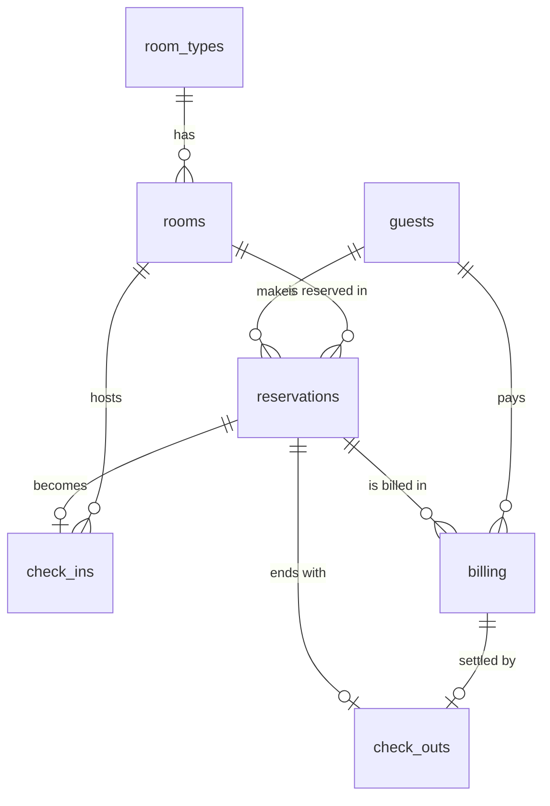

# Hotel Reservation System

Software Engineering - Construction Phase (one continuous project).

## Technologies

- HTML, CSS, JavaScript (no framework needed)
- Database: browser localStorage, designed with the tables from Stage 2
  (an equivalent SQL script is in `database/hotel_database.sql`)

## Folder Structure

```
hotel-reservation-system/
├── index.html            <- main page (layout)
├── README.md
├── css/
│   └── style.css         <- all styling
├── js/
│   ├── schema.js         <- database design: tables, keys, constraints (Stage 2)
│   ├── database.js       <- connection + insert/update/delete with validation
│   ├── database-page.js  <- "Database" page: data dictionary, sample data, tests
│   ├── courses.js        <- EXAM: Course Management (CRUD) + dropdown helpers
│   ├── guests.js         <- EXAM: Guests data entry form with Course field
│   └── app.js            <- menu, pages, dashboard, logout
├── database/
│   └── hotel_database.sql  <- SQL version of the same design
└── images/
```

## How to Run

Open `index.html` in a web browser (or use the VS Code "Live Server" extension).

Open the **Database** menu to load sample data and run the constraint tests.

## Entity Relationship Diagram



(The `users` table is separate; it is used for login and roles.)

(Exam addition: the `courses` table is linked to `guests` through `guests.course_id`.)
